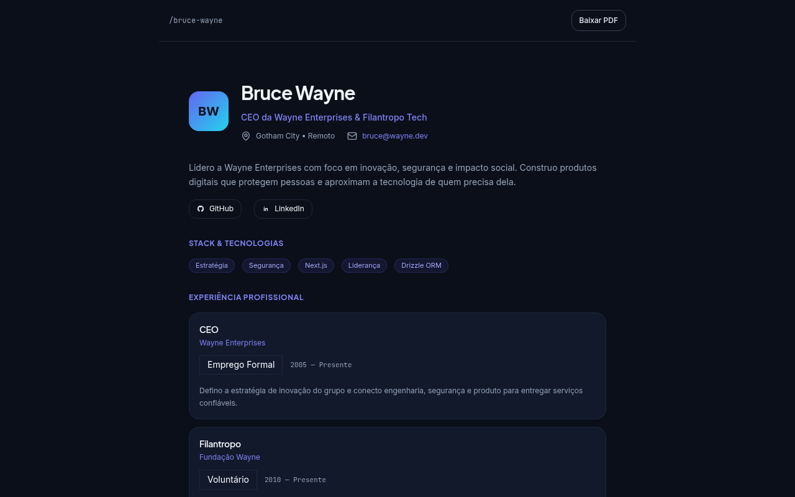

# FolioCraft

FolioCraft is a portfolio/resume generator built as a single Next.js 15 App Router application. Users
create an account, edit a profile in a split-screen editor with a live preview, pick one of three
typed templates, publish at `/[slug]`, and export a real PDF.



The product specification lives in [`docs/SPEC.md`](docs/SPEC.md) (in Portuguese).

## Stack

- **Next.js 15 App Router + React 19 + TypeScript strict** — server-first routing with statically
  generated public pages and type-safe boundaries.
- **Tailwind CSS v4** — utility styling driven by typed CSS variables so templates cannot drift.
- **Postgres 16 + Drizzle ORM** — relational data with migrations and a small typed query layer.
- **Better Auth** — verified email/password sign-in, password reset, and optional GitHub OAuth.
- **Nodemailer + Mailpit** — realistic SMTP delivery locally without an external email provider.
- **Zod** — one source of truth for form validation, Server Actions, and boot-time environment
  validation.
- **react-hook-form** — autosaving editor forms with accessible field-level errors.
- **Playwright** — real browser PDF rendering and end-to-end coverage.
- **Vitest + Testing Library + MSW** — unit, component, and integration tests at the right boundary.
- **Biome, Lefthook, commitlint, pnpm** — one formatter/linter, local hooks, Conventional Commits,
  and a single package manager.

## Routes and rendering

| Route                                 | Render                      | Behavior                                                                                                               |
| ------------------------------------- | --------------------------- | ---------------------------------------------------------------------------------------------------------------------- |
| `/`                                   | SSG                         | Landing page with signup CTA and link to the demo profile                                                              |
| `/explore`                            | ISR 300s + `revalidatePath` | Published profiles, 12 per page; page 1 at `/explore`, next at `/explore/page/[n]`                                     |
| `/[slug]`                             | **SSG + ISR**               | `generateStaticParams` (published, max 100), `revalidate = 300`, dynamic params, 404 for drafts, 301/308 for old slugs |
| `/[slug]/print`                       | SSR                         | Single PDF source; `noindex`; 404 for drafts; resolves old slugs                                                       |
| `/api/pdf/[slug]`                     | Node runtime                | Playwright renders A4 PDF; 404 for drafts; 503 when Chromium fails                                                     |
| `/[slug]/opengraph-image`             | Node runtime                | `ImageResponse` 1200×630 using the profile theme; 404 for drafts                                                       |
| `/opengraph-image`                    | Node runtime                | Landing page OpenGraph image                                                                                           |
| `/sitemap.xml`, `/robots.txt`         | `sitemap.ts` / `robots.ts`  | Published profiles only; dashboard, auth, and API paths blocked                                                        |
| `/login`, `/signup`                   | SSR                         | Better Auth                                                                                                            |
| `/forgot-password`, `/reset-password` | SSR                         | Email-based reset flow (Mailpit locally)                                                                               |
| `/dashboard`                          | Dynamic SSR                 | The editor itself, protected by a session                                                                              |
| `/dashboard/settings`                 | Dynamic SSR                 | Password, connected GitHub account, account deletion                                                                   |
| `/api/auth/[...all]`                  | —                           | Better Auth handler                                                                                                    |
| 404                                   | —                           | Dedicated reused page                                                                                                  |

Slugs are 3–30 characters matching `^[a-z0-9]+(?:-[a-z0-9]+)*$`, with reserved names blocked and
case-insensitive comparison. Renaming a slug writes the old value to `slug_history` and responds with
a permanent redirect.

## Architecture

```
src/app/                 routes, Server Actions, metadata, sitemap, robots, OG images
src/components/ui/       accessible primitives (button, input, tabs, dialog, …)
src/components/marketing/ landing and explore surfaces
src/components/auth/     login, signup, verification, password reset forms
src/components/editor/   split-screen editor, tabs, autosave, live preview
src/components/portfolio/ shared renderer for public pages, preview, and print
src/components/settings/ account settings
src/lib/db/              Drizzle schema, client, queries, test helpers
src/lib/validation/      Zod schemas shared by forms and Server Actions
src/lib/                 auth, email, SEO, templates, slugs, PDF renderer, env parsing
drizzle/                 versioned SQL migrations
scripts/seed.ts          idempotent demo data (Bruce Wayne, Clark Kent)
tests/e2e/               Playwright specs and database/email helpers
```

Data flow: the editor saves drafts through Server Actions, which revalidate the affected paths;
public pages and `/explore` read published profiles through `src/lib/db/queries.ts`; the PDF endpoint
loads `/[slug]/print` in Playwright. Preview, public page, and print all render the same
`PortfolioPage` component with tokens from the selected template.

## Local auth and email

Better Auth handles email/password accounts with verified emails and optional GitHub OAuth when
`GITHUB_CLIENT_ID` and `GITHUB_CLIENT_SECRET` are set. Verification and password-reset messages go
through Nodemailer to Mailpit:

- SMTP: `localhost:1025` (host `localhost`, port `1025`)
- Mailpit web UI: `http://localhost:8025`

## Setup

Requirements: Node 24, pnpm 10, Podman with the Compose provider, and a Chromium binary for PDF
export and screenshot capture.

```bash
mise install
pnpm install
pnpm infra:up        # Postgres 16 + Mailpit via Podman Compose
cp .env.example .env # adjust values as needed
pnpm db:migrate
pnpm seed
pnpm dev             # http://localhost:3000
```

`pnpm seed` is idempotent: it upserts both demo users and profiles and can be run again at any time.

## Demo credentials

| Account | Email             | Password          | Profile               |
| ------- | ----------------- | ----------------- | --------------------- |
| Bruce   | `bruce@wayne.dev` | `foliocraft-demo` | `/bruce-wayne`        |
| Clark   | `clark@wayne.dev` | `foliocraft-demo` | `/clark-kent` (draft) |

`/clark-kent` is intentionally unpublished: it returns 404 and is absent from `/explore` and the
sitemap.

## Scripts

| Command                             | Purpose                                          |
| ----------------------------------- | ------------------------------------------------ |
| `pnpm dev`                          | Start the Next.js development server             |
| `pnpm build`                        | Production build                                 |
| `pnpm start`                        | Serve the production build                       |
| `pnpm lint`                         | Biome check                                      |
| `pnpm format`                       | Biome format (write)                             |
| `pnpm typecheck`                    | TypeScript check without emit                    |
| `pnpm test`                         | Vitest unit, component, and integration projects |
| `pnpm test:e2e`                     | Playwright end-to-end suite                      |
| `pnpm test:a11y`                    | Accessibility and keyboard specs                 |
| `pnpm db:migrate`                   | Apply Drizzle migrations                         |
| `pnpm db:generate`                  | Generate a migration from schema changes         |
| `pnpm db:studio`                    | Open Drizzle Studio                              |
| `pnpm seed`                         | Upsert demo users and profiles                   |
| `pnpm infra:up` / `pnpm infra:down` | Start/stop Postgres and Mailpit                  |

## Tests and CI

```bash
pnpm lint && pnpm typecheck && pnpm test
pnpm seed && pnpm test:e2e
pnpm build
```

Unit and component tests are co-located with source files; integration tests use the real
`foliocraft_test` database; Playwright runs against the full local stack with `workers: 1`. See
[`docs/TESTING.md`](docs/TESTING.md) for details.

GitHub Actions runs three jobs on pushes to `main` and on pull requests:

1. **checks** — install, lint, typecheck, and Vitest with a Postgres service.
2. **build** — install, migrate, and `next build` with Postgres and the full env block.
3. **e2e** — install, migrate, idempotent `pnpm seed`, install Chromium, and run Playwright with
   Postgres and Mailpit services; the Playwright report is uploaded on failure.

## Verification

Run the full gate locally before shipping:

```bash
pnpm lint && pnpm typecheck && pnpm test && pnpm build
pnpm seed && pnpm test:e2e
pnpm test:a11y
```

`pnpm test:a11y` checks serious and critical axe violations on all public routes and the
authenticated dashboard, plus keyboard operation of the editor and the account-deletion dialog.
Most QA scenarios are automated; the following are exercised by deterministic fixtures and can
also be inspected manually: a profile with zero sections, 100 skills, a long bio, one-word or empty
names, an accented slug, an empty-profile PDF, and a draft on every public endpoint. See
[`docs/TESTING.md`](docs/TESTING.md) for the complete Review Focus map.

## SEO checklist

- `generateMetadata` provides a title, truncated description, canonical URL, OpenGraph, and Twitter
  card data.
- `Person` JSON-LD includes name, headline, bio, URL, OG image, GitHub/LinkedIn links, and location,
  with `<` escaped.
- Dynamic 1200×630 OpenGraph images use the profile's template tokens.
- `sitemap.xml` lists the landing page, `/explore`, and published profiles only.
- `robots.txt` allows public pages and blocks dashboard, auth, and API paths.
- Drafts return 404 everywhere; `/[slug]/print` and the PDF API are `noindex`.

## Scope and non-goals

FolioCraft ships one typed profile per account with three templates (Minimal, Developer, Modern) in
light and dark modes. It does not include image uploads, contact forms, comments, analytics or view
counts, notifications beyond verification/reset, custom domains, multiple resumes per account,
content translation/i18n, or arbitrary user CSS, colors, and fonts.

## Known limitations

- PDF generation requires a Chromium binary at runtime; a missing browser returns 503.
- No deployment target is configured. A container is the natural path because PDF rendering needs
  Chromium; the `PdfRenderer` interface keeps the renderer replaceable.
- Custom domains and user-supplied CSS/fonts are deliberately unsupported.
- Content is pt-BR only; there is no i18n layer.
